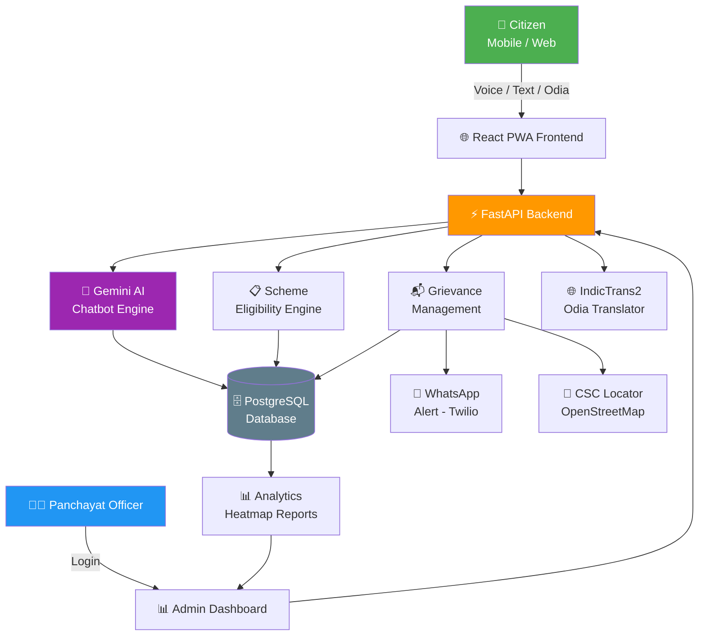
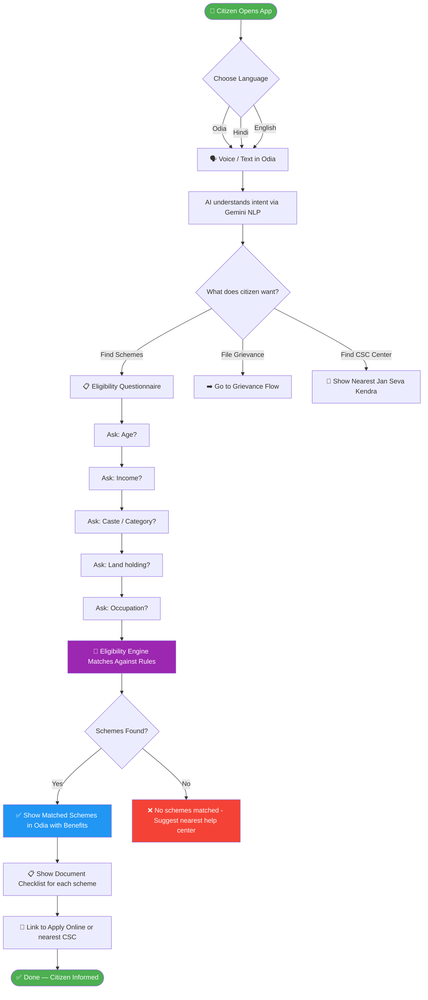
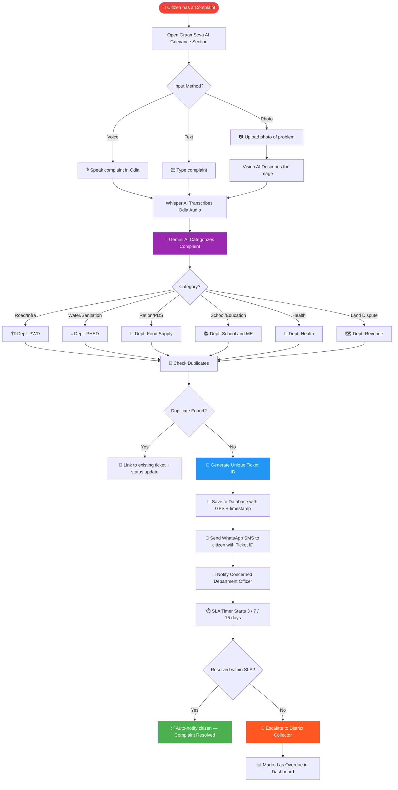
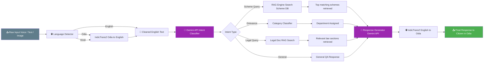
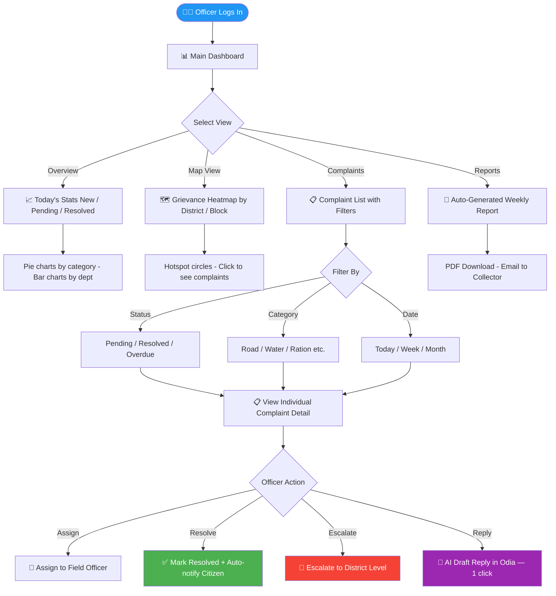
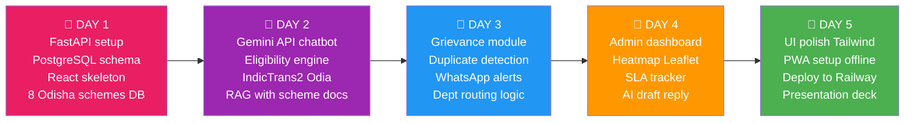
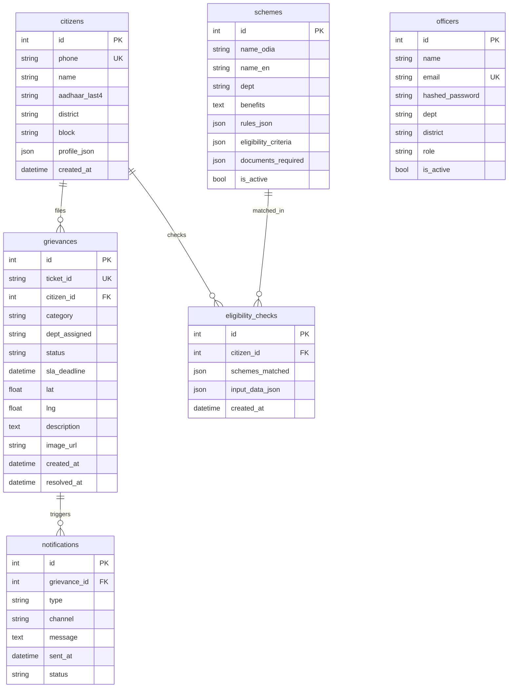

# GraamSeva AI — Architecture Flowcharts
> AI for Governance & Social Good | Odisha AI Hackathon 2026

## 1️⃣ Overall System Architecture

## 2️⃣ Citizen — Scheme Eligibility Flow

## 3️⃣ Grievance Filing Flow

## 4️⃣ AI Processing Pipeline

## 5️⃣ Admin Dashboard Flow

## 6️⃣ 5-Day Build Timeline

## 7️⃣ Database Schema

